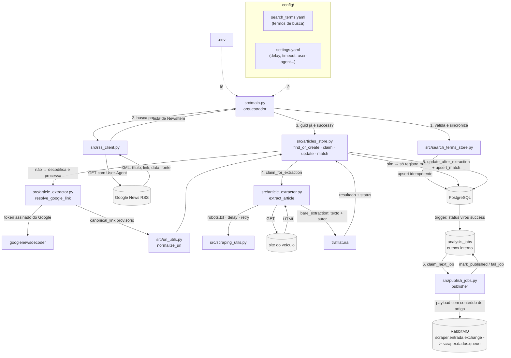

# Coletor de notícias políticas (Google News RSS)

Script Python que busca notícias por termos de busca configuráveis usando o feed RSS público do Google News — que agrega várias fontes numa única consulta, sem precisar de um scraper por site —, entra em cada link retornado, extrai o texto completo do artigo e salva tudo em PostgreSQL, com deduplicação em camadas e uma fila para um futuro pipeline de análise/IA.

Escopo deste repositório: **coleta, persistência e publicação da fila de análise**. A classificação do conteúdo (LSTM, regras) roda em outro repositório (`classifier-prisma`), que **nunca acessa este Postgres diretamente** — a fronteira entre os dois é o RabbitMQ. Este repositório mantém `analysis_jobs` como fila interna (outbox transacional) e tem um publisher (`src/publish_jobs.py`) que lê essa fila e publica cada job no RabbitMQ com o conteúdo do artigo embutido. Ver seção [Publisher (analysis_jobs → RabbitMQ)](#publisher-analysis_jobs--rabbitmq).

## Arquitetura



### Modelo de dados

- **`search_terms`** — os termos de busca configurados no YAML, sincronizados no banco. `id` estável, `query`/`category`/`entity`/`topic`/`retrieval_type` versionáveis.
- **`articles`** — um artigo é uma linha só, **independente de quantos termos o encontraram**. Deduplicação em camadas: `google_guid` (quando o RSS traz um) → `canonical_link` (URL normalizada, sem parâmetros de rastreamento) → `content_hash` (calculado e indexado para detecção futura de republicação, sem consolidar automaticamente).
- **`article_search_matches`** — relação M:N entre artigo e termo, com **snapshot** dos campos do termo no momento em que a relação foi criada (não muda retroativamente se o termo mudar depois).
- **`analysis_jobs`** — fila alimentada automaticamente por um trigger no Postgres sempre que `articles.extraction_status` vira `success`. Nenhum modelo de IA é chamado por este repositório. Funciona como **outbox transacional interno**: o trigger grava a linha na mesma transação que marca o artigo como `success` (garante que "artigo pronto" e "job criado" nunca fiquem dessincronizados), e o publisher (`src/publish_jobs.py`) entrega o job para fora, publicando no RabbitMQ. Interface de manipulação em `src/jobs_store.py`. Status detalhados na seção [Publisher](#publisher-analysis_jobs--rabbitmq).

#### Status de extração (`articles.extraction_status`)

| Status | Significado |
|---|---|
| `pending` | Artigo descoberto, ainda não teve extração tentada. |
| `processing` | Extração em andamento (claim atômico — evita duas execuções sobrepostas processarem o mesmo artigo). |
| `success` | Texto completo extraído normalmente. Dispara o enfileiramento em `analysis_jobs`. |
| `paywalled` | Texto extraído abaixo do limiar configurado — teaser truncado, comportamento normal em sites pagos. **Não recuperável automaticamente** (repetir não muda o resultado). |
| `blocked` | O site recusou a requisição (HTTP 403/429) — bloqueio explícito, sem retry nem tentativa de contornar. **Não recuperável automaticamente**. |
| `skipped_robots` | O `robots.txt` do site proíbe a coleta dessa URL — respeitado, não ignorado. Recuperável (robots.txt é rechecado a cada tentativa). |
| `empty` | Página acessada, mas sem conteúdo textual aproveitável. Recuperável. |
| `failed` | Erro de rede, timeout esgotado ou falha ao decodificar o link. Recuperável. |

### Responsabilidade de cada módulo

| Arquivo | Responsabilidade |
|---|---|
| `src/main.py` | Entrypoint único. Migra o schema, sincroniza termos, orquestra o fluxo por item (achar/criar artigo → extrair se necessário → registrar match) e loga o resumo. |
| `src/search_terms_store.py` | Valida `search_terms.yaml` (mensagens de erro citam termo + campo) e sincroniza (`upsert`) com a tabela `search_terms`, sem apagar termos ausentes do YAML. |
| `src/rss_client.py` | Monta a URL do RSS do Google News por termo e normaliza os itens retornados (`NewsItem`). |
| `src/article_extractor.py` | `resolve_google_link`: decodifica o link ofuscado do Google (via `googlenewsdecoder`) para a URL real. `extract_article`: dado um link já resolvido, checa `robots.txt`, respeita rate limit, baixa a página e extrai texto + autor com `trafilatura`. |
| `src/scraping_utils.py` | Scraping responsável: delay com jitter, checagem de `robots.txt`, `GET` com timeout e retry limitado (nunca retry em bloqueio explícito). |
| `src/url_utils.py` | Normalização de URL para dedup (`normalize_url`) e extração de `<link rel="canonical">` do HTML. |
| `src/jobs_store.py` | Interface de manipulação de `analysis_jobs`: `claim_next_job` (`FOR UPDATE SKIP LOCKED`, sem duas execuções pegarem o mesmo job), `fail_job` (retry por `attempts`/`max_attempts`) e `mark_published`. |
| `src/articles_store.py` | Camada de persistência de artigos: find-or-create seguro sob concorrência, claim atômico para extração, update pós-extração, upsert de match, hash de conteúdo, e `find_for_publishing` (leitura dos campos que o publisher embute no payload). |
| `src/target_entities.py` | Carrega e valida `config/target_entities.yaml` (candidatos/partidos no escopo do Classifier). Só leitura — não toca em banco nem é chamado por `src/main.py` ainda. Ver seção [`config/target_entities.yaml`](#configtarget_entitiesyaml--entidades-alvo-do-classifier). |
| `src/rabbitmq_client.py` | Wrapper fino sobre `pika` (síncrono, como o resto do projeto): conecta e publica mensagens JSON persistentes com confirmação de entrega. Não declara/cria exchange nem fila (isso é responsabilidade do DevOps — detalhes em [RabbitMQ: topologia e troubleshooting](#rabbitmq-topologia-e-troubleshooting)) e não conhece regra de negócio. |
| `src/jobs_publisher.py` | Orquestra a publicação: reaproveita `claim_next_job`/`fail_job`, busca o artigo via `articles_store.find_for_publishing`, monta o payload (`build_payload`) e chama o publisher injetado — aceita qualquer objeto com `.publish(dict)`, o que permite testar com um fake sem broker real. Tem circuit breaker para falhas consecutivas (detalhes na seção Publisher). |
| `src/publish_jobs.py` | Entrypoint do publisher — mesmo padrão do `src/main.py` (roda uma vez e sai, agendável via cron). |
| `src/storage.py` | Conexão com o Postgres e o runner de migrations (`db/migrations/`). |

**Por que essa separação**: cada módulo tem uma única razão para mudar. Não há ORM, framework de crawling ou camadas extras — para o tamanho do projeto, SQL direto e funções simples resolvem sem complexidade desnecessária. Decisões de design detalhadas vivem nos comentários dos próprios arquivos de migration (`db/migrations/`) — ex.: por que `find_or_create_article` não usa um único `ON CONFLICT`, por que `canonical_link` não muda depois do fetch.

## Configuração

| Arquivo | Conteúdo |
|---|---|
| `config/search_terms.yaml` | Termos de busca — ver abaixo. |
| `config/settings.yaml` | Parâmetros técnicos: delay entre requisições, timeout, número de tentativas, limiar de caracteres para detectar paywall, User-Agent usado nas requisições. |
| `config/target_entities.yaml` | Lista de candidatos/partidos no escopo do Classifier — ver abaixo. Não versionado por padrão (exportado de outro repositório); `config/target_entities.example.yaml` traz um exemplo completo com dado real. |
| `.env` | Credenciais do Postgres e config do RabbitMQ — ver tabela abaixo. Nunca commitar; use `.env.example` como referência. |

### `config/search_terms.yaml`

Lista de termos de busca, validada antes de qualquer coleta. Campos por termo:

| Campo | Obrigatório | Descrição |
|---|---|---|
| `id` | sim | Identificador único e estável. |
| `query` | sim | Consulta enviada ao Google News. |
| `category` | sim | Categoria funcional da pesquisa (livre — ex: `politician`, `party`, `topic`). |
| `entity` | não | Político, partido, instituição ou entidade principal. |
| `topic` | não | Tema relacionado, quando existir. |
| `retrieval_type` | não | Um de `neutral`, `opinion_query`, `entity_topic`, `event`. Ausente vira `neutral`. |
| `enabled` | não (default `true`) | Só termos habilitados são executados. |

Adicionar, desabilitar ou editar um termo é só mudar o YAML — a próxima execução sincroniza sozinha (`upsert`, nunca apaga termos ausentes do arquivo). Se o YAML tiver um problema (campo obrigatório faltando, `id` duplicado, `retrieval_type` inválido), o script para antes de coletar e informa exatamente qual termo e qual campo.

**Escopo da v1 (Classifier)**: a v1 do `classifier-prisma` só classifica notícias sobre candidatos a presidente/vice-presidente e os partidos vinculados a eles (critério TSE). Por isso os termos com `category: federation`, `political_group`, `election`, `institution` e `topic` estão com `enabled: false` — cobrem federações partidárias, eleições em geral, instituições e temas de política pública que não citam um candidato ou partido específico do escopo. Ficam desabilitados, não removidos, para reativar rápido se o escopo for ampliado (`enabled: true` no termo desejado).

**Decisão registrada**: este arquivo continua estático (mapeamento manual de 1 alias = 1 termo de busca) — gerar os termos dinamicamente a partir de `target_entities.yaml` foi avaliado e adiado para depois da v1. O mapeamento direto já resolve o essencial e é mais fácil de debugar; só vale a complexidade extra se, na prática, for necessário um termo que não está nos aliases do Classifier (ex.: variação regional/abreviação que o TSE não registra).

### `config/target_entities.yaml` — entidades-alvo do Classifier

O `classifier-prisma` exporta a lista de entidades no escopo da v1 (candidatos a presidente/vice-presidente + partidos vinculados, critério TSE `ds_cargo IN ('PRESIDENTE', 'VICE-PRESIDENTE')`). O arquivo **não é gerado neste repositório** — vem do `classifier-prisma`, que é quem tem acesso ao banco (`app_db2`) onde a lista oficial de candidatos vive (`entidade_matching`, importada do TSE). Este repositório não acessa esse banco diretamente (mesma decisão de arquitetura da fronteira via RabbitMQ — ver ADR 0001 do `classifier-prisma`), então o processo de atualização é manual.

Formato e cadência confirmados com o time do Classifier em 2026-08-29:

- **Geração sob demanda, não agendada.** A lista de candidatos muda por evento raro e conhecido (substituição, impugnação, desistência), não por tempo — regerar todo dia seria trabalho automático para um dado que quase nunca muda. O Classifier gera um novo export e avisa quando a lista mudar de verdade (registrado do lado deles em `pendencias-tecnicas.md`). Uma rede de segurança futura (job semanal que regera e avisa se algo mudou sem aviso prévio) é uma melhoria opcional, não bloqueia a v1.
- **`entity_id` é a mesma chave usada em `app_db2`** (`nr_titulo_eleitoral_candidato` para políticos, `nr_partido` para partidos) — permite cruzar dado com o Classifier sem duplicar lógica de match.

Formato do arquivo (ver `config/target_entities.example.yaml` para um exemplo completo com dado real):

```yaml
generated_at: "2026-08-29T19:29:23Z"   # ISO 8601, quando o Classifier gerou o export
schema_version: 1
source: "classifier-prisma/entidade_matching (TSE 2026, escopo v1: presidente + vice-presidente)"
entities:
  - entity_id: '13'                     # nr_partido ou nr_titulo_eleitoral_candidato, sempre tratado como string
    entity_type: partido                # partido | politico
    cargo: null                         # PRESIDENTE | VICE-PRESIDENTE | null (só null para partido)
    nome_principal: PARTIDO DOS TRABALHADORES
    aliases:
      - PT
      - PARTIDO DOS TRABALHADORES
```

`src/target_entities.py` carrega e valida esse YAML (mesmo padrão de `src/search_terms_store.py`: erros agregados, mensagens citando `entity_id`/campo). Validações incluem: `entity_type` só pode ser `partido`/`politico`; `partido` não pode ter `cargo` preenchido e `politico` precisa ter; `aliases` não pode vir vazio; `entity_id` sem aspas no YAML (ex.: `108563260302`) é normalizado para `str` mesmo se o parser interpretar como inteiro — números de título eleitoral/partido não podem perder zero à esquerda por causa de como o YAML resolve tipos implicitamente. `check_freshness(generated_at, max_age_days)` avisa (sem travar nada) se o export estiver mais velho que o esperado — como a geração é sob demanda, isso é só um sinal informativo, não um erro.

**Ainda não existe, de propósito**: integração de `target_entities.py` com `src/main.py`. A decisão de como/quando o pipeline de coleta deve consumir essa lista (faseamento) é separada e ainda não foi implementada.

#### Como gerar e aplicar uma atualização

Gere uma versão nova **sob demanda**, quando:
- alguém confirmar que uma candidatura do escopo (presidente ou vice) mudou de verdade;
- houver suspeita concreta de que a lista está desatualizada (ex.: notícia sobre um candidato que não aparece no arquivo).

Não gere "por precaução" ou em intervalo fixo.

1. **Gerar** (do lado do `classifier-prisma`, requer acesso ao repositório e às credenciais do `app_db2`):
   ```bash
   cd caminho/para/classifier-prisma
   .venv/bin/python scripts/export_target_entities.py
   ```
   Saída esperada:
   ```
   Exportado: 26 políticos + 14 partidos = 40 entidades -> .../data/exports/target_entities.yaml
   Lembre-se de copiar este arquivo manualmente para scrapping-prisma/config/target_entities.yaml.
   ```
   Os números variam conforme a lista de candidatos — o que importa é que os dois números aparecem e batem com o total. O script só lê o banco, não altera nada em `app_db2`.
2. **Copiar** para este repositório:
   ```bash
   cp caminho/para/classifier-prisma/data/exports/target_entities.yaml caminho/para/scrapping-prisma/config/target_entities.yaml
   ```
3. **Conferir `schema_version`** no cabeçalho do arquivo copiado. Se for diferente de `1`, **pare** e confirme com quem mantém o `classifier-prisma` antes de seguir — pode ser um formato novo que este README ainda não cobre.
4. **Rodar os testes** que dependem desse arquivo antes de commitar:
   ```bash
   pytest tests/test_target_entities.py
   ```
5. **Commit** normal, mencionando o motivo (ex.: `chore: atualiza target_entities.yaml -- troca de vice do candidato X`).

**Se algo der errado**:
- **Contagem de entidades muito diferente do esperado** (ex.: de repente aparecem 200 em vez de ~40): não copie o arquivo — algo mudou no filtro do lado do Classifier (ex.: escopo da fase mudou de presidente/vice para outro cargo) e vale confirmar antes de propagar isso para o scraper.
- **`schema_version` diferente de 1**: pare e converse com quem mantém o `classifier-prisma` — o formato pode ter mudado.
- **Dúvida sobre se uma mudança de candidatura é "real" o suficiente para justificar regenerar**: melhor perguntar do que regenerar sem necessidade ou deixar de regenerar quando precisava.

### `.env`

| Variável | Default | Descrição |
|---|---|---|
| `POSTGRES_HOST` / `PORT` / `DB` / `USER` / `PASSWORD` | — | Credenciais do Postgres de desenvolvimento. |
| `POSTGRES_TEST_DB` | `politica_test` | Banco lógico separado usado pelos testes (mesmo servidor). |
| `RABBITMQ_HOST` | `localhost` | Host do broker. |
| `RABBITMQ_PORT` | `5672` | Porta AMQP. |
| `RABBITMQ_USER` / `RABBITMQ_PASSWORD` | `guest` / `guest` | Credenciais. |
| `RABBITMQ_VHOST` | `/` | Virtual host. |
| `RABBITMQ_QUEUE` | `scraper.dados.queue` | Fila onde o Classifier consome. Confirmado pelo DevOps. |
| `RABBITMQ_EXCHANGE` | `scraper.entrada.exchange` | Exchange nomeada. Confirmado pelo DevOps. |
| `RABBITMQ_EXCHANGE_TYPE` | `direct` | Informativo — o publisher não declara a exchange, só documenta o tipo já confirmado. |
| `RABBITMQ_ROUTING_KEY` | mesmo valor de `RABBITMQ_QUEUE` | **Ainda não confirmada pelo DevOps** — hipótese, não valor fechado. Ver [RabbitMQ: topologia e troubleshooting](#rabbitmq-topologia-e-troubleshooting). |
| `RABBITMQ_DURABLE` | `true` | Se as mensagens são persistentes (`delivery_mode=2`). Não declara fila/exchange. |

Se algum valor de RabbitMQ mudar, ajuste o `.env` (ou os defaults em `src/rabbitmq_client.py`, se o novo padrão valer para todo mundo) — nenhuma mudança de código é necessária.

## Rodando localmente

Pré-requisitos: Python 3.11+, Docker.

```bash
# 1. clonar e entrar no projeto
git clone git@gitea.intranet.ajvale.com.br:projetos-periodo-8/scrapping.git politica
cd politica

# 2. configurar variáveis de ambiente
cp .env.example .env   # ajuste a senha se quiser

# 3. subir o Postgres
docker compose up -d

# 4. criar o ambiente virtual e instalar dependências
python3 -m venv .venv
source .venv/bin/activate
pip install -r requirements.txt

# 5. rodar o script
python src/main.py
```

> **Se você usa fish** (não bash/zsh), o passo 4 muda: `source .venv/bin/activate.fish` em vez de `source .venv/bin/activate`.

O script aplica as migrations pendentes sozinho a cada execução (não precisa rodar nada à parte) e sincroniza `search_terms.yaml` com o banco antes de coletar. Pode ser executado manualmente quantas vezes quiser: artigos já coletados com sucesso não são reprocessados, e o mesmo artigo encontrado por dois termos diferentes gera duas relações, não duas linhas.

### Comandos úteis para conferir os dados

```bash
# shell interativo do Postgres
docker compose exec postgres psql -U politica -d politica

# contagem de artigos por status
docker compose exec -T postgres psql -U politica -d politica -c \
  "SELECT extraction_status, count(*) FROM articles GROUP BY extraction_status ORDER BY count(*) DESC;"

# quantos artigos cada termo já encontrou
docker compose exec -T postgres psql -U politica -d politica -c \
  "SELECT search_term_id, count(*) FROM article_search_matches GROUP BY search_term_id ORDER BY count(*) DESC LIMIT 10;"

# fila de análise pendente
docker compose exec -T postgres psql -U politica -d politica -c \
  "SELECT status, count(*) FROM analysis_jobs GROUP BY status;"
```

## Migrations

Não há Alembic nem outra ferramenta pesada — `db/migrations/` tem scripts numerados (`.sql` para DDL, `.py` para operações que precisam ler o YAML ou reaproveitar funções Python, como o backfill de dados legados). Uma tabela `schema_migrations` rastreia o que já rodou; cada migration é aplicada dentro da mesma transação do seu registro (se falhar, nada fica marcado como aplicado). `python src/main.py` já aplica migrations pendentes automaticamente — não é preciso um comando separado.

Para aplicar manualmente sem rodar o scraper (útil em deploy):

```bash
python3 -c "
import sys; sys.path.insert(0, 'src')
from dotenv import load_dotenv; load_dotenv('.env')
from storage import get_connection, run_migrations
conn = get_connection()
print(run_migrations(conn))
conn.close()
"
```

## Testes

```bash
docker compose up -d      # o Postgres precisa estar rodando
pip install -r requirements.txt
pytest
```

Os testes rodam contra um banco Postgres **separado** (`POSTGRES_TEST_DB`, mesmo servidor do `docker-compose`, banco lógico diferente — nunca toca nos dados de desenvolvimento). `tests/conftest.py` cria o banco se não existir, aplica as migrations do zero e limpa as tabelas antes de cada teste. `tests/test_migrations.py` usa um banco totalmente à parte (criado e destruído a cada execução) porque precisa simular um estado "no meio da migração" para validar que dados legados são preservados.

Cobertura: validação de YAML (válido/inválido, mensagens claras), sincronização idempotente de termos, deduplicação por `guid` e por `canonical_link`, hash de conteúdo determinístico, um artigo achado por dois termos gerando duas relações sem duplicar o artigo, preservação do snapshot mesmo com o termo mudando depois, limpeza de erro ao passar de `failed` para `success`, criação/não-duplicação de trabalhos na fila via o trigger do Postgres, concorrência básica no find-or-create, validação de `target_entities.yaml`, e a migração de dados legados de ponta a ponta. Os testes do publisher (`tests/test_jobs_publisher.py`) ficam detalhados na seção abaixo.

## Publisher (analysis_jobs → RabbitMQ)

`src/publish_jobs.py` entrega `analysis_jobs` para fora deste repositório. Existe porque o `classifier-prisma` **nunca acessa o Postgres do scraper diretamente** — a fronteira entre os dois serviços é o RabbitMQ (decisão registrada em `context.md` da raiz do monorepo, seção 7.3, e em `classifier-prisma/context.md`, seção 3).

### O que ele faz

A cada execução, o publisher:

1. Reaproveita `jobs_store.claim_next_job` para reservar, um de cada vez, todos os jobs `pending` disponíveis no momento (mesmo `FOR UPDATE SKIP LOCKED` que já protege o worker contra duas execuções pegarem o mesmo job — nada de lógica de claim nova).
2. Para cada job, busca os campos do artigo com `articles_store.find_for_publishing` e monta uma mensagem JSON com **o conteúdo embutido** (título, texto completo, `canonical_link`, `source_name`, `published_at`, `article_id`, `job_id`, `pipeline_version`, `schema_version`) — o Classifier nunca precisa voltar a este Postgres para buscar dado.
3. Publica a mensagem no RabbitMQ (com `mandatory=True` e confirmação de entrega habilitada — ver [RabbitMQ: topologia e troubleshooting](#rabbitmq-topologia-e-troubleshooting)).
4. Se publicar com sucesso, marca o job como `published_job` (`jobs_store.mark_published`). O nome evita ambiguidade com `article.published_at` (data em que a notícia foi publicada pelo veículo original — conceito diferente).
5. Se a publicação falhar (broker indisponível, mensagem não roteada, erro de conexão etc.), chama `jobs_store.fail_job`, reaproveitando o retry por `attempts`/`max_attempts` já existente e testado. Falhas em sequência acionam o circuit breaker abaixo.

### Circuit breaker

`jobs_publisher.publish_pending_jobs` conta falhas de publicação **consecutivas** (não intercaladas por sucessos). Ao atingir `MAX_CONSECUTIVE_FAILURES` (3), a execução para e retorna a contagem parcial de publicados/falhos, deixando os jobs restantes como `pending` para a próxima execução agendada. Falha de "artigo não encontrado" (problema do job, não do broker) não conta para esse limite. Isso evita bater centenas de vezes contra um broker indisponível numa fila grande.

### Status de `analysis_jobs`

| Status | Significado |
|---|---|
| `pending` | Job criado pelo trigger, ainda não foi publicado. |
| `processing` | Reservado por `claim_next_job` (claim atômico do publisher). |
| `published_job` | Publicado com sucesso no RabbitMQ. |
| `failed` | Falha ao publicar e tentativas esgotadas (`attempts >= max_attempts`). |
| `cancelled` | Não usado atualmente — reservado para cancelamento manual por um operador. |

### Como rodar

```bash
docker compose up -d      # Postgres precisa estar rodando
# um RabbitMQ acessível via RABBITMQ_HOST/PORT (local, docker, ou já provisionado)
python src/publish_jobs.py
```

Roda uma vez e sai (`exit 0` se todos os jobs pendentes foram publicados, `exit 1` se algum falhou ou se não deu para conectar ao RabbitMQ) — mesmo padrão do `src/main.py`, deliberadamente **sem processo daemon/contínuo**, para não introduzir uma arquitetura de infraestrutura mais complexa do que o problema exige. Se um dia fizer sentido consumir/publicar continuamente, isso é uma escolha a revisar, não uma limitação técnica.

### Como testar

```bash
docker compose up -d
pip install -r requirements.txt
pytest tests/test_jobs_publisher.py
```

Roda contra o mesmo banco Postgres isolado dos demais testes (`POSTGRES_TEST_DB`) e **não precisa de um RabbitMQ real** — um `FakePublisher` (mock simples com `.publish(dict)`) substitui `RabbitMQPublisher`, tanto no caminho feliz quanto simulando falha de conexão. Cobre: publicação marca o job como `published_job` e ele deixa de ser retornado por `claim_next_job`; falha na publicação aciona `fail_job`; rodar o publisher duas vezes seguidas não publica o mesmo job de novo (idempotência); o payload publicado contém os campos esperados; e o circuit breaker interrompe a execução após `MAX_CONSECUTIVE_FAILURES` falhas seguidas.

**Não há teste de integração com um RabbitMQ real neste repositório ainda** — ficaria mais robusto ter um, mas exigiria decidir a topologia primeiro (ver seção abaixo). Se quiser adicionar depois, o padrão já usado para o Postgres de teste serve de referência: subir o broker via `docker compose` (um serviço `rabbitmq` com a imagem `rabbitmq:3-management`, por exemplo) e um teste que sobe `RabbitMQPublisher` de verdade contra ele.

## Agendamento (cron)

Nem `src/main.py` nem `src/publish_jobs.py` têm scheduler embutido — cada execução roda uma vez e termina (`exit 0` sucesso, `exit 1` se algo falhou). Agende como preferir, por exemplo via `cron`:

```cron
0 7 * * * cd /caminho/do/projeto && /caminho/do/projeto/.venv/bin/python src/main.py >> logs/cron.log 2>&1
*/15 * * * * cd /caminho/do/projeto && /caminho/do/projeto/.venv/bin/python src/publish_jobs.py >> logs/cron.log 2>&1
```

## Limitações conhecidas

- **Sites bloqueiam IPs de servidor/datacenter.** É esperado que uma fração dos artigos fique com status `blocked`. Isso é tratado como falha parcial normal — os metadados do artigo já ficam salvos mesmo quando o texto completo falha, e **este projeto não implementa, nem deve implementar, rotação de proxy/IP** ou qualquer mecanismo para burlar bloqueio de segurança de um site.
- **O link do RSS do Google News não é mais um redirect HTTP simples.** A lib `googlenewsdecoder` decodifica o token assinado do Google para chegar na URL real — não é um mecanismo de segurança sendo contornado, é como o feed público funciona hoje.
- **Deduplicação por `content_hash`** é calculada e indexada, mas **não consolida automaticamente** dois artigos nesta versão — fica disponível para uma futura rotina de detecção de republicação, sem apagar registros.
- Para domínios que bloqueiam sistematicamente e exigirem alta confiabilidade de texto completo, a alternativa é uma API de notícias licenciada (ex: NewsAPI.org, GNews, SerpApi) — não implementado aqui, fica como opção futura.

## RabbitMQ: topologia e troubleshooting

**Este repositório não declara exchange, fila nem faz bind.** O time de DevOps cria e mantém essa topologia diretamente na configuração do broker. `RabbitMQPublisher._connect()` só abre a conexão e o canal — se o código tentasse declarar algo com argumentos que não batem exatamente com o que já existe no broker (ex.: argumentos de dead-letter na fila), o RabbitMQ rejeitaria a conexão com `PRECONDITION_FAILED`.

Nomes confirmados pelo DevOps:

| Item | Valor | Observação |
|---|---|---|
| Exchange | `scraper.entrada.exchange` | Tipo `direct`, durável. |
| Fila | `scraper.dados.queue` | Durável, consumida pelo Classifier. |
| Dead-letter queue | `scraper.dados.dlq` | Gerenciada pelo DevOps do lado do broker/consumidor — este publisher (produtor) não referencia isso diretamente, não há nada a implementar aqui. |

**⚠️ Routing key ainda não confirmada.** O binding exato entre a exchange e a fila (routing key) ainda depende de confirmação do DevOps. O comportamento atual usa como default o nome da fila (`RABBITMQ_ROUTING_KEY`, configurável — ver tabela em [Configuração > .env](#env)), mas isso é uma hipótese, não um valor fechado — não assuma que está certo em produção sem confirmar.

Confiabilidade do lado do publisher (mensagens não podem se perder):

- **`mandatory=True`** em `basic_publish` — se não houver fila com binding correspondente à routing key, o broker devolve a mensagem em vez de descartá-la silenciosamente.
- **Confirmação de entrega** (`channel.confirm_delivery()`) — o broker confirma (ack) ou recusa (nack) cada mensagem publicada; `RabbitMQPublisher.publish()` levanta `PublishError` (que aciona `fail_job`/retry) se a mensagem não for roteada (`UnroutableError`) ou for recusada (`NackError`), em vez de assumir sucesso só por não ter dado erro de conexão.
- **Filas duráveis + mensagens persistentes** (`RABBITMQ_DURABLE=true`, `delivery_mode=2`).

## Dependências

| Pacote | Por quê |
|---|---|
| `feedparser` | Parseia o XML do RSS de forma robusta (encoding, CDATA, campo `<source>` do Google News). |
| `requests` | Cliente HTTP para o RSS, para os artigos e para o `robots.txt` — mesma stack TLS em todo o projeto. |
| `googlenewsdecoder` | Decodifica o link ofuscado do Google News para a URL real do veículo. |
| `trafilatura` | Extrai texto principal e metadados (autor, data) do HTML do artigo. |
| `lxml` | Parsing de HTML para extrair `<link rel="canonical">` — declarado direto (não só transitivo via `trafilatura`) para não quebrar silenciosamente se essa dependência interna mudar. |
| `psycopg[binary]` | Driver de conexão com o PostgreSQL. |
| `python-dotenv` | Carrega o `.env` sem precisar exportar variáveis manualmente. |
| `PyYAML` | Lê os arquivos de configuração. |
| `pika` | Cliente RabbitMQ usado pelo publisher (`src/publish_jobs.py`). Síncrono e bloqueante — mesmo estilo do resto do projeto (`requests`, `psycopg`), sem precisar migrar para `asyncio`. É a biblioteca Python mais madura e mantida para AMQP 0-9-1 (protocolo do RabbitMQ), então foi a escolha natural em vez de introduzir um cliente menos consolidado. |
| `pytest` | Framework de testes. |
