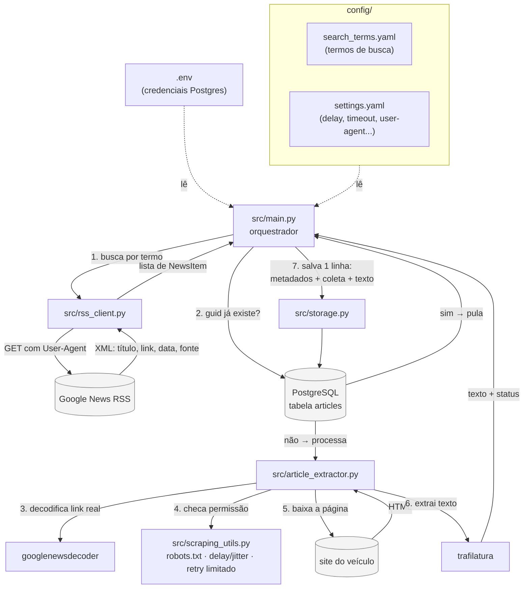

# Coletor de notícias políticas (Google News RSS)

Script Python que busca notícias por strings de busca específicas usando o feed RSS público do Google News — que agrega várias fontes numa única consulta, sem precisar de um scraper por site —, entra em cada link retornado, extrai o texto completo do artigo e salva tudo em PostgreSQL.

Escopo deste repositório: **só a coleta e persistência**. Classificação do conteúdo (LSTM, regras) e envio para um bucket são etapas futuras, separadas, fora daqui.

## Arquitetura



### Responsabilidade de cada módulo

| Arquivo | Responsabilidade |
|---|---|
| `src/main.py` | Entrypoint único. Carrega config, orquestra o fluxo (busca → dedup → extrai → salva) e loga o resumo da execução. |
| `src/rss_client.py` | Monta a URL do RSS do Google News por termo de busca e normaliza os itens retornados (`NewsItem`). |
| `src/article_extractor.py` | Para um item: decodifica o link real, checa `robots.txt`, aplica rate limit, baixa a página e extrai o texto com `trafilatura`. Classifica o `extraction_status`. |
| `src/scraping_utils.py` | Utilitários de scraping responsável: delay com jitter, checagem de `robots.txt`, `GET` com timeout e retry limitado (sem retry em bloqueio explícito). |
| `src/storage.py` | Conexão com o Postgres, aplica o schema e faz o `INSERT` com deduplicação por `guid`. |
| `db/schema.sql` | Definição da tabela `articles`. |

**Por que essa separação**: cada módulo tem uma única razão para mudar — trocar a fonte de busca (RSS → outra) mexe só em `rss_client.py`; trocar a forma de extrair texto mexe só em `article_extractor.py`; trocar de Postgres para outro banco mexe só em `storage.py`. Não há ORM, framework de crawling ou camadas extras — para o tamanho do projeto (uma tabela, um fluxo linear), SQL direto e funções simples resolvem sem complexidade desnecessária.

## Rodando localmente

Pré-requisitos: Python 3.11+, Docker.

```bash
# 1. clonar e entrar no projeto
git clone git@gitea.intranet.ajvale.com.br:projetos-periodo-8/scrapping.git politica
cd politica

# 2. configurar variáveis de ambiente
cp .env.example .env   # ajuste a senha se quiser

# 3. subir o Postgres
docker compose up -d

# 4. criar o ambiente virtual e instalar dependências
python3 -m venv .venv
source .venv/bin/activate
pip install -r requirements.txt

# 5. rodar o script
python src/main.py
```

> **Se você usa fish** (não bash/zsh), o passo 4 muda: `source .venv/bin/activate.fish` em vez de `source .venv/bin/activate`.

O script cria o schema do banco sozinho na primeira execução (`db/schema.sql`) — não precisa rodar migration à parte. Pode ser executado manualmente quantas vezes quiser: artigos já coletados (mesmo `guid`) são pulados, então rodar de novo não duplica nem reprocessa.

### Comandos úteis para conferir os dados

```bash
# shell interativo do Postgres
docker compose exec postgres psql -U politica -d politica

# contagem de artigos por status, direto do terminal
docker compose exec -T postgres psql -U politica -d politica -c \
  "SELECT extraction_status, count(*) FROM articles GROUP BY extraction_status ORDER BY count(*) DESC;"
```

## Agendamento (cron)

O script não tem scheduler embutido — cada execução roda uma vez e termina (`exit 0` sucesso, `exit 1` se algum termo falhou ao buscar o RSS). Agende como preferir, por exemplo via `cron`:

```cron
0 7 * * * cd /caminho/do/projeto && /caminho/do/projeto/.venv/bin/python src/main.py >> logs/cron.log 2>&1
```

## Configuração

- `config/search_terms.yaml`: lista de termos de busca (`id`, `query`, `enabled`). Adicionar um termo novo não exige mudar código.
- `config/settings.yaml`: parâmetros técnicos — delay entre requisições, timeout, número de tentativas, limiar de caracteres para detectar paywall, User-Agent usado nas requisições.
- `.env`: credenciais do Postgres (`POSTGRES_HOST/PORT/DB/USER/PASSWORD`). Nunca commitar o `.env` — use `.env.example` como referência.

## Status de extração por artigo

Cada artigo salvo tem um `extraction_status`:

| Status | Significado |
|---|---|
| `success` | Texto completo extraído normalmente. |
| `paywalled` | O site retornou só um teaser truncado (texto abaixo do limiar configurado) — comportamento normal em sites pagos, não é bug do extrator. |
| `blocked` | O site recusou a requisição (HTTP 403/429) — bloqueio explícito, não há retry nem tentativa de contornar. |
| `skipped_robots` | O `robots.txt` do site proíbe a coleta dessa URL — respeitado, não é ignorado. |
| `failed` | Erro de rede, timeout esgotado, ou a extração não encontrou conteúdo. |

Execução real de teste com 2 termos de busca (200 artigos): 175 `success`, 15 `paywalled`, 6 `blocked`, 3 `failed`, 1 `skipped_robots`.

## Limitações conhecidas

- **Sites bloqueiam IPs de servidor/datacenter.** É esperado que uma fração dos artigos fique com status `blocked`, especialmente rodando de um servidor cloud. Isso é tratado como falha parcial normal — os metadados do artigo (título, link, fonte, data) já ficam salvos mesmo quando o texto completo falha.
- **Este projeto não implementa, e não deve implementar, rotação de proxy/IP ou qualquer mecanismo para burlar bloqueio de segurança de um site.** Isso normalmente viola os Termos de Uso dos veículos.
- **O link do RSS do Google News não é mais um redirect HTTP simples.** Desde uma mudança do Google, o link aponta para uma página que exige decodificar um token assinado para chegar na URL real do veículo. A lib `googlenewsdecoder` cuida disso — não é um mecanismo de segurança sendo contornado, é como o feed público funciona hoje.
- Para os domínios que bloqueiam sistematicamente e exigirem alta confiabilidade de texto completo, a alternativa é usar uma API de notícias licenciada para aquele domínio (ex: NewsAPI.org, GNews, SerpApi Google News API) — não implementado aqui, fica como opção futura.

## Dependências

| Pacote | Por quê |
|---|---|
| `feedparser` | Parseia o XML do RSS de forma robusta (encoding, CDATA, campo `<source>` do Google News). |
| `requests` | Cliente HTTP para o RSS, para os artigos e para o `robots.txt` — mesma stack TLS em todo o projeto. |
| `googlenewsdecoder` | Decodifica o link ofuscado do Google News para a URL real do veículo. |
| `trafilatura` | Extrai o texto principal e metadados do HTML do artigo, com boa generalização entre templates de sites diferentes. |
| `psycopg[binary]` | Driver de conexão com o PostgreSQL. |
| `python-dotenv` | Carrega o `.env` sem precisar exportar variáveis manualmente. |
| `PyYAML` | Lê os arquivos de configuração. |
