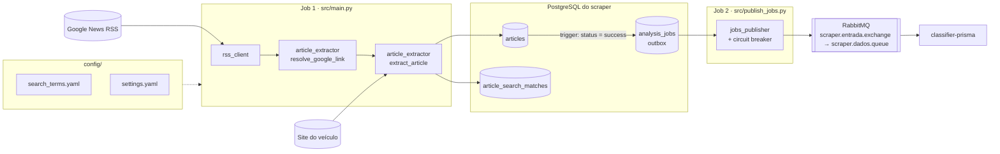

<div align="center">

# 📰 scrapping-prisma

**Coletor de notícias políticas do PRISMA**: busca matérias no Google News RSS, extrai o texto completo, deduplica, persiste em PostgreSQL e publica cada artigo no RabbitMQ para classificação.


[Organização PRISMA](https://github.com/prisma-projetos) · [Documentação e experimentos](https://github.com/prisma-projetos/experiments-prisma)

</div>

---

## 📍 Onde este módulo fica no PRISMA

```
[ scrapping-prisma ] ──RabbitMQ──▶ classifier-prisma ──RabbitMQ──▶ analyser-prisma ──▶ System DB ──▶ api-prisma ──▶ app-prisma
   ▲ você está aqui
```

O scraper é a **porta de entrada de dados**. Ele tem banco próprio, e nenhum outro módulo acessa esse banco: a fronteira com o `classifier-prisma` é o RabbitMQ ([ADR 0001](https://github.com/prisma-projetos/experiments-prisma/blob/main/docs/adr/0001-scraper-classifier-rabbitmq-outbox.md)).

## 📑 Sumário

- [Visão geral](#-visão-geral)
- [Arquitetura](#-arquitetura)
- [Modelo de dados](#-modelo-de-dados)
- [Estrutura do repositório](#-estrutura-do-repositório)
- [Como rodar](#-como-rodar)
- [Configuração](#-configuração)
- [Publisher (analysis_jobs → RabbitMQ)](#-publisher-analysis_jobs--rabbitmq)
- [Testes](#-testes)
- [CI/CD e operação](#-cicd-e-operação)
- [Limitações conhecidas](#-limitações-conhecidas)
- [Repositórios do PRISMA](#-repositórios-do-prisma)

## 🔎 Visão geral

| | |
|---|---|
| **Entrada** | Termos de busca em `config/search_terms.yaml` (políticos, partidos, temas) |
| **Fonte** | Feed RSS público do Google News, que agrega vários veículos numa única consulta |
| **Processamento** | Decodifica o link do Google, respeita `robots.txt`, baixa a página e extrai texto + autor com `trafilatura` |
| **Persistência** | PostgreSQL próprio, com deduplicação em camadas (`guid` → URL canônica → hash do conteúdo) |
| **Saída** | Uma mensagem por artigo extraído na fila `scraper.dados.queue`, com o conteúdo embutido |
| **Execução** | Dois jobs *run-once* (coleta e publicação), agendáveis via cron ou CronJob do Kubernetes |

**Fora do escopo:** classificar conteúdo (é papel do [`classifier-prisma`](https://github.com/prisma-projetos/classifier-prisma)), contornar bloqueios de sites ou rotacionar IP/proxy.

## 🏗 Arquitetura



Fluxo por item do RSS:

1. **Sincroniza termos**: valida `search_terms.yaml` e faz *upsert* em `search_terms`. Termos que saem do YAML não são apagados.
2. **Busca** cada termo habilitado no Google News RSS.
3. **Deduplica**: se o artigo já foi extraído com sucesso, só registra o novo *match* termo↔artigo.
4. **Extrai**: faz *claim* atômico, checa `robots.txt`, aplica *rate limit* e baixa e extrai o texto.
5. **Enfileira**: um trigger do Postgres cria o job em `analysis_jobs` **na mesma transação** que marca o artigo como `success`. É o padrão *transactional outbox*.
6. **Publica**: o publisher drena `analysis_jobs` e envia cada job ao RabbitMQ com confirmação de entrega.

## 🗄 Modelo de dados

| Tabela | Papel |
|---|---|
| `search_terms` | Termos do YAML sincronizados no banco (`id` estável, demais campos versionáveis). |
| `articles` | Um artigo por linha, **independente de quantos termos o encontraram**. Deduplicação: `google_guid` → `canonical_link` → `content_hash` (este último só é indexado, sem consolidação automática). |
| `article_search_matches` | Relação N:N artigo↔termo, com **snapshot** dos campos do termo no momento do match. |
| `analysis_jobs` | Outbox interno alimentado por trigger. Status: `pending` → `processing` → `published_job` \| `failed` (`cancelled` fica reservado). |
| `schema_migrations` | Controle das migrations já aplicadas. |

<details>
<summary><b>Status de extração (<code>articles.extraction_status</code>)</b></summary>

| Status | Significado | Recuperável? |
|---|---|---|
| `pending` | Descoberto, extração ainda não tentada | — |
| `processing` | Extração em andamento (claim atômico) | — |
| `success` | Texto completo extraído; dispara o job em `analysis_jobs` | — |
| `paywalled` | Texto abaixo do limiar configurado (teaser de site pago) | ❌ |
| `blocked` | O site respondeu HTTP 403/429; não há retry | ❌ |
| `skipped_robots` | O `robots.txt` proíbe a URL | ✅ (rechecado a cada tentativa) |
| `empty` | Página sem conteúdo aproveitável | ✅ |
| `failed` | Erro de rede, timeout ou falha ao decodificar o link | ✅ |

</details>

Migrations: scripts numerados em `db/migrations/` (`.sql` para DDL, `.py` para *backfills*), aplicados automaticamente por `src/main.py`, cada um na mesma transação do seu registro em `schema_migrations`. Não há ORM nem Alembic.

## 📂 Estrutura do repositório

```
├── config/
│   ├── search_terms.yaml              # termos de busca (versionado)
│   ├── settings.yaml                  # delay, timeout, retries, limiar de paywall, User-Agent
│   └── target_entities.example.yaml   # entidades-alvo exportadas pelo classifier
├── db/
│   ├── schema.sql
│   └── migrations/                    # 0001..0013 (.sql e .py)
├── docker/Dockerfile
├── src/
│   ├── main.py                 # entrypoint 1: coleta
│   ├── publish_jobs.py         # entrypoint 2: publicação no RabbitMQ
│   ├── search_terms_store.py   # validação e sync do YAML
│   ├── rss_client.py           # Google News RSS → NewsItem
│   ├── article_extractor.py    # decodificação do link + extração (trafilatura)
│   ├── scraping_utils.py       # robots.txt, delay com jitter, retry limitado
│   ├── url_utils.py            # normalização de URL e <link rel="canonical">
│   ├── articles_store.py       # find-or-create, claim, update, match, hash
│   ├── jobs_store.py           # claim (FOR UPDATE SKIP LOCKED), fail, mark_published
│   ├── jobs_publisher.py       # orquestra a publicação + circuit breaker
│   ├── rabbitmq_client.py      # wrapper fino sobre pika (publisher confirms)
│   ├── target_entities.py      # carga e validação de target_entities.yaml
│   └── storage.py              # conexão + runner de migrations
├── tests/                      # pytest contra Postgres isolado
├── docker-compose.yml          # Postgres + app para desenvolvimento
└── .gitea/workflows/ci-cd.yaml # build → manifestos → ArgoCD
```

## 🚀 Como rodar

**Pré-requisitos:** Python 3.11+ e Docker.

```bash
git clone git@github.com:prisma-projetos/scrapping-prisma.git
cd scrapping-prisma

cp .env.example .env              # ajuste as credenciais
docker compose up -d postgres     # sobe só o Postgres

python3 -m venv .venv && source .venv/bin/activate   # fish: source .venv/bin/activate.fish
pip install -r requirements.txt

python src/main.py                # coleta (aplica migrations e sincroniza termos)
python src/publish_jobs.py        # publica os jobs pendentes no RabbitMQ
```

Os dois comandos são **idempotentes**: artigos já extraídos não são reprocessados e jobs já publicados não são reenviados.

<details>
<summary><b>Rodando tudo em container</b></summary>

```bash
docker compose up -d --build                                  # Postgres + coleta
docker compose run --rm app python src/publish_jobs.py        # publicação
```

Dentro da rede do compose, `POSTGRES_HOST` é sobrescrito para `postgres`.

</details>

<details>
<summary><b>Consultas úteis</b></summary>

```bash
# artigos por status
docker compose exec -T postgres psql -U politica -d politica -c \
  "SELECT extraction_status, count(*) FROM articles GROUP BY 1 ORDER BY 2 DESC;"

# artigos por termo
docker compose exec -T postgres psql -U politica -d politica -c \
  "SELECT search_term_id, count(*) FROM article_search_matches GROUP BY 1 ORDER BY 2 DESC LIMIT 10;"

# fila de publicação
docker compose exec -T postgres psql -U politica -d politica -c \
  "SELECT status, count(*) FROM analysis_jobs GROUP BY 1;"
```

</details>

## ⚙ Configuração

| Arquivo | Conteúdo |
|---|---|
| `config/search_terms.yaml` | Termos de busca (detalhes abaixo) |
| `config/settings.yaml` | Delay entre requisições, timeout, tentativas, limiar de paywall e User-Agent |
| `config/target_entities.yaml` | Candidatos e partidos no escopo do classifier. Não é versionado; veja o `.example` |
| `.env` | Credenciais do Postgres e do RabbitMQ. **Nunca commitar** |

### `search_terms.yaml`

| Campo | Obrigatório | Descrição |
|---|---|---|
| `id` | ✅ | Identificador único e estável |
| `query` | ✅ | Consulta enviada ao Google News |
| `category` | ✅ | `politician`, `party`, `topic`, … (texto livre) |
| `entity` / `topic` | — | Entidade principal e tema relacionado |
| `retrieval_type` | — | `neutral` (padrão), `opinion_query`, `entity_topic` ou `event` |
| `enabled` | — | Padrão `true`. Só termos habilitados são executados |

> **Escopo v1:** o classifier só processa candidatos a **presidente e vice** e seus partidos. Por isso termos com `category` `federation`, `political_group`, `election`, `institution` e `topic` estão com `enabled: false`. Eles foram desabilitados, e não removidos, para poderem ser reativados se o escopo crescer.

### Variáveis de ambiente

| Variável | Padrão | Descrição |
|---|---|---|
| `POSTGRES_HOST` / `PORT` / `DB` / `USER` / `PASSWORD` | — | Banco do scraper |
| `POSTGRES_TEST_DB` | `politica_test` | Banco lógico isolado para testes |
| `RABBITMQ_HOST` / `RABBITMQ_PORT` | `localhost` / `5672` | Broker |
| `RABBITMQ_USER` / `RABBITMQ_PASSWORD` | `guest` / `guest` | Credenciais |
| `RABBITMQ_VHOST` | `/` | Virtual host |
| `RABBITMQ_EXCHANGE` | `scraper.entrada.exchange` | Exchange `direct`, durável |
| `RABBITMQ_QUEUE` | `scraper.dados.queue` | Fila consumida pelo classifier |
| `RABBITMQ_ROUTING_KEY` | valor de `RABBITMQ_QUEUE` | ⚠ Ainda é uma hipótese, a confirmar com a infra |
| `RABBITMQ_DURABLE` | `true` | Mensagens persistentes (`delivery_mode=2`) |

<details>
<summary><b>Atualizando <code>target_entities.yaml</code> (exportado pelo classifier)</b></summary>

A lista oficial de candidatos vive no System DB, ao qual este repositório não tem acesso. Por isso o arquivo é gerado no `classifier-prisma`, **sob demanda**, quando uma candidatura do escopo muda de fato:

```bash
# no classifier-prisma
.venv/bin/python scripts/export_target_entities.py
# copie para cá
cp ../classifier-prisma/data/exports/target_entities.yaml config/target_entities.yaml
pytest tests/test_target_entities.py
```

- Confira `schema_version: 1`. Se for outro valor, pare e fale com quem mantém o classifier.
- Se a contagem de entidades mudar muito (o normal é cerca de 40), não propague o arquivo antes de confirmar o motivo.
- `entity_id` é sempre tratado como string, para não perder zeros à esquerda do título eleitoral.

Guia completo: [`scraper-como-atualizar-target-entities.md`](https://github.com/prisma-projetos/experiments-prisma/blob/main/docs/scraper-como-atualizar-target-entities.md).

</details>

## 📤 Publisher (analysis_jobs → RabbitMQ)

`src/publish_jobs.py` roda uma vez e sai: `exit 0` quando publica tudo e `exit 1` quando algum job falha ou o broker está inacessível.

1. Reserva jobs `pending` com `claim_next_job` (`FOR UPDATE SKIP LOCKED`).
2. Monta o payload **com o conteúdo embutido** (`article_id`, `job_id`, título, texto, `canonical_link`, `source_name`, `published_at`, `pipeline_version`, `schema_version`). Assim o classifier nunca precisa voltar a este banco.
3. Publica com `mandatory=True` e *publisher confirms*. Mensagem não roteada ou recebida com `nack` vira falha.
4. Em caso de sucesso, marca `published_job`. Em caso de falha, chama `fail_job`, que faz retry por `attempts`/`max_attempts`.
5. **Circuit breaker:** depois de 3 falhas de broker **consecutivas**, interrompe a execução e deixa o restante como `pending`.

> O publisher **não declara** exchange, fila nem binding. A topologia (incluindo a DLQ `scraper.dados.dlq`) é provisionada pela infra. Declarar algo com argumentos divergentes causaria `PRECONDITION_FAILED`.

## 🧪 Testes

```bash
docker compose up -d postgres
pytest                                  # suíte completa
pytest tests/test_jobs_publisher.py     # apenas o publisher
```

- Os testes rodam contra um banco **isolado** (`POSTGRES_TEST_DB`), criado e migrado pelo `tests/conftest.py` e truncado antes de cada teste.
- `test_migrations.py` usa um banco descartável próprio para validar a migração de dados legados.
- O publisher é testado com um `FakePublisher`, sem broker real. Ainda não há teste de integração com RabbitMQ.

Cobertura principal: validação de YAML, sync idempotente de termos, deduplicação por `guid` e por URL canônica, snapshot de match, trigger do outbox, concorrência no find-or-create, idempotência do publisher e circuit breaker.

## 🔁 CI/CD e operação

| Etapa | Como |
|---|---|
| **Build** | `docker/Dockerfile` (`python:3.11-slim`) |
| **Pipeline** | `.gitea/workflows/ci-cd.yaml` em push para `main`/`develop`: build da imagem → atualização dos manifestos → sync no **ArgoCD** (GitOps), usando *reusable workflows* compartilhados |
| **Agendamento** | Os dois entrypoints são *run-once*. Use cron ou CronJob do Kubernetes |

```cron
0 7 * * *    cd /srv/scrapping-prisma && .venv/bin/python src/main.py         >> logs/cron.log 2>&1
*/15 * * * * cd /srv/scrapping-prisma && .venv/bin/python src/publish_jobs.py >> logs/cron.log 2>&1
```

## ⚠ Limitações conhecidas

- **Bloqueio de IPs de datacenter**: uma parte dos artigos termina como `blocked`. Isso é tratado como falha parcial esperada, e os metadados ficam salvos. Não há, e não deve haver, mecanismo para burlar bloqueios.
- **Link do Google News**: deixou de ser um redirect simples. `googlenewsdecoder` decodifica o token público do feed.
- **`content_hash`** é calculado e indexado, mas ainda não consolida republicações.
- Para domínios com bloqueio sistemático, a alternativa futura é uma API licenciada (NewsAPI, GNews, SerpApi).

<details>
<summary><b>Dependências e por que cada uma existe</b></summary>

| Pacote | Uso |
|---|---|
| `feedparser` | Parse robusto do RSS (encoding, CDATA, `<source>`) |
| `requests` | HTTP para o RSS, os artigos e o `robots.txt` |
| `googlenewsdecoder` | Decodifica o link do Google News para a URL do veículo |
| `trafilatura` | Extração do texto principal e de metadados |
| `lxml` | `<link rel="canonical">`, declarado explicitamente |
| `psycopg[binary]` | Driver PostgreSQL |
| `pika` | Cliente AMQP síncrono, no mesmo estilo do restante do código |
| `PyYAML`, `python-dotenv` | Configuração |
| `pytest` | Testes |

</details>

## 🧭 Repositórios do PRISMA

| Repositório | Papel |
|---|---|
| [`.github`](https://github.com/prisma-projetos) | Página da organização |
| **`scrapping-prisma`** | 📰 Coleta de notícias *(este)* |
| [`classifier-prisma`](https://github.com/prisma-projetos/classifier-prisma) | 🏷 Identificação de entidades e classificação do teor |
| [`analyser-prisma`](https://github.com/prisma-projetos/analyser-prisma) | 🧠 Resumos e panoramas com LLM |
| [`api-prisma`](https://github.com/prisma-projetos/api-prisma) | 🔌 API REST somente leitura |
| [`app-prisma`](https://github.com/prisma-projetos/app-prisma) | 🖥 Interface web |
| [`experiments-prisma`](https://github.com/prisma-projetos/experiments-prisma) | 🔬 Documentação, ADRs e experimentos do artigo |
