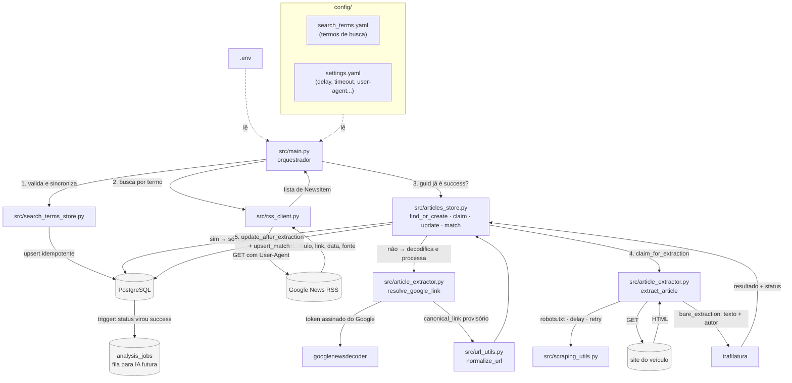

# Coletor de notícias políticas (Google News RSS)

Script Python que busca notícias por termos de busca configuráveis usando o feed RSS público do Google News — que agrega várias fontes numa única consulta, sem precisar de um scraper por site —, entra em cada link retornado, extrai o texto completo do artigo e salva tudo em PostgreSQL, com deduplicação em camadas e uma fila para um futuro pipeline de análise/IA.

Escopo deste repositório: **só a coleta e persistência**. Classificação do conteúdo (LSTM, regras) e envio para um bucket são etapas futuras, separadas, que só consomem a fila (`analysis_jobs`) daqui.

## Arquitetura



### Modelo de dados

- **`search_terms`** — os termos de busca configurados no YAML, sincronizados no banco. `id` estável, `query`/`category`/`entity`/`topic`/`retrieval_type` versionáveis.
- **`articles`** — um artigo é uma linha só, **independente de quantos termos o encontraram**. Deduplicação em camadas: `google_guid` (quando o RSS traz um) → `canonical_link` (URL normalizada, sem parâmetros de rastreamento) → `content_hash` (calculado e indexado para detecção futura de republicação, sem consolidar automaticamente).
- **`article_search_matches`** — relação M:N entre artigo e termo, com **snapshot** dos campos do termo no momento em que a relação foi criada (não muda retroativamente se o termo mudar depois).
- **`analysis_jobs`** — fila alimentada automaticamente por um trigger no Postgres sempre que `articles.extraction_status` vira `success`. Nenhum modelo de IA é chamado por este repositório — só a fila e uma interface mínima de worker (`src/jobs_store.py`).

### Responsabilidade de cada módulo

| Arquivo | Responsabilidade |
|---|---|
| `src/main.py` | Entrypoint único. Migra o schema, sincroniza termos, orquestra o fluxo por item (achar/criar artigo → extrair se necessário → registrar match) e loga o resumo. |
| `src/search_terms_store.py` | Valida `search_terms.yaml` (mensagens de erro citam termo + campo) e sincroniza (`upsert`) com a tabela `search_terms`, sem apagar termos ausentes do YAML. |
| `src/rss_client.py` | Monta a URL do RSS do Google News por termo e normaliza os itens retornados (`NewsItem`). |
| `src/article_extractor.py` | `resolve_google_link`: decodifica o link ofuscado do Google (via `googlenewsdecoder`) para a URL real. `extract_article`: dado um link já resolvido, checa `robots.txt`, respeita rate limit, baixa a página e extrai texto + autor com `trafilatura`. |
| `src/scraping_utils.py` | Scraping responsável: delay com jitter, checagem de `robots.txt`, `GET` com timeout e retry limitado (nunca retry em bloqueio explícito). |
| `src/url_utils.py` | Normalização de URL para dedup (`normalize_url`) e extração de `<link rel="canonical">` do HTML. |
| `src/articles_store.py` | Camada de persistência de artigos: find-or-create seguro sob concorrência, claim atômico para extração, update pós-extração, upsert de match, hash de conteúdo. |
| `src/jobs_store.py` | Interface mínima para um worker futuro consumir `analysis_jobs` (`FOR UPDATE SKIP LOCKED`, sem duas execuções pegarem o mesmo job). |
| `src/storage.py` | Conexão com o Postgres e o runner de migrations (`db/migrations/`). |

**Por que essa separação**: cada módulo tem uma única razão para mudar. Não há ORM, framework de crawling ou camadas extras — para o tamanho do projeto, SQL direto e funções simples resolvem sem complexidade desnecessária. Ver decisões de design detalhadas nos comentários dos próprios arquivos de migration (`db/migrations/`), que explicam o porquê de cada escolha (ex.: por que `find_or_create_article` não usa um único `ON CONFLICT`, por que `canonical_link` não muda depois do fetch).

## Rodando localmente

Pré-requisitos: Python 3.11+, Docker.

```bash
# 1. clonar e entrar no projeto
git clone git@gitea.intranet.ajvale.com.br:projetos-periodo-8/scrapping.git politica
cd politica

# 2. configurar variáveis de ambiente
cp .env.example .env   # ajuste a senha se quiser

# 3. subir o Postgres
docker compose up -d

# 4. criar o ambiente virtual e instalar dependências
python3 -m venv .venv
source .venv/bin/activate
pip install -r requirements.txt

# 5. rodar o script
python src/main.py
```

> **Se você usa fish** (não bash/zsh), o passo 4 muda: `source .venv/bin/activate.fish` em vez de `source .venv/bin/activate`.

O script aplica as migrations pendentes sozinho a cada execução (não precisa rodar nada à parte) e sincroniza `search_terms.yaml` com o banco antes de coletar. Pode ser executado manualmente quantas vezes quiser: artigos já coletados com sucesso não são reprocessados, e o mesmo artigo encontrado por dois termos diferentes gera duas relações, não duas linhas.

### Comandos úteis para conferir os dados

```bash
# shell interativo do Postgres
docker compose exec postgres psql -U politica -d politica

# contagem de artigos por status
docker compose exec -T postgres psql -U politica -d politica -c \
  "SELECT extraction_status, count(*) FROM articles GROUP BY extraction_status ORDER BY count(*) DESC;"

# quantos artigos cada termo já encontrou
docker compose exec -T postgres psql -U politica -d politica -c \
  "SELECT search_term_id, count(*) FROM article_search_matches GROUP BY search_term_id ORDER BY count(*) DESC LIMIT 10;"

# fila de análise pendente
docker compose exec -T postgres psql -U politica -d politica -c \
  "SELECT status, count(*) FROM analysis_jobs GROUP BY status;"
```

## Migrations

Não há Alembic nem outra ferramenta pesada — `db/migrations/` tem scripts numerados (`.sql` para DDL, `.py` para operações que precisam ler o YAML ou reaproveitar funções Python, como o backfill de dados legados). Uma tabela `schema_migrations` rastreia o que já rodou; cada migration é aplicada dentro da mesma transação do seu registro (se falhar, nada fica marcado como aplicado). `python src/main.py` já aplica migrations pendentes automaticamente — não é preciso um comando separado.

Para aplicar manualmente sem rodar o scraper (útil em deploy):

```bash
python3 -c "
import sys; sys.path.insert(0, 'src')
from dotenv import load_dotenv; load_dotenv('.env')
from storage import get_connection, run_migrations
conn = get_connection()
print(run_migrations(conn))
conn.close()
"
```

## Testes

```bash
docker compose up -d      # o Postgres precisa estar rodando
pip install -r requirements.txt
pytest
```

Os testes rodam contra um banco Postgres **separado** (`POSTGRES_TEST_DB`, mesmo servidor do `docker-compose`, banco lógico diferente — nunca toca nos dados de desenvolvimento). `tests/conftest.py` cria o banco se não existir, aplica as migrations do zero e limpa as tabelas antes de cada teste. `tests/test_migrations.py` usa um banco totalmente à parte (criado e destruído a cada execução) porque precisa simular um estado "no meio da migração" para validar que dados legados são preservados.

Cobertura: validação de YAML (válido/inválido, mensagens claras), sincronização idempotente de termos, deduplicação por `guid` e por `canonical_link`, hash de conteúdo determinístico, um artigo achado por dois termos gerando duas relações sem duplicar o artigo, preservação do snapshot mesmo com o termo mudando depois, limpeza de erro ao passar de `failed` para `success`, criação/não-duplicação de trabalhos na fila via o trigger do Postgres, concorrência básica no find-or-create, e a migração de dados legados de ponta a ponta.

## Agendamento (cron)

O script não tem scheduler embutido — cada execução roda uma vez e termina (`exit 0` sucesso, `exit 1` se algo falhou). Agende como preferir, por exemplo via `cron`:

```cron
0 7 * * * cd /caminho/do/projeto && /caminho/do/projeto/.venv/bin/python src/main.py >> logs/cron.log 2>&1
```

## Configuração

`config/search_terms.yaml` — lista de termos de busca, validada antes de qualquer coleta. Campos por termo:

| Campo | Obrigatório | Descrição |
|---|---|---|
| `id` | sim | Identificador único e estável. |
| `query` | sim | Consulta enviada ao Google News. |
| `category` | sim | Categoria funcional da pesquisa (livre — ex: `politician`, `party`, `topic`). |
| `entity` | não | Político, partido, instituição ou entidade principal. |
| `topic` | não | Tema relacionado, quando existir. |
| `retrieval_type` | não | Um de `neutral`, `opinion_query`, `entity_topic`, `event`. Ausente vira `neutral`. |
| `enabled` | não (default `true`) | Só termos habilitados são executados. |

Adicionar, desabilitar ou editar um termo é só mudar o YAML — a próxima execução sincroniza sozinha (`upsert`, nunca apaga termos ausentes do arquivo). Se o YAML tiver um problema (campo obrigatório faltando, `id` duplicado, `retrieval_type` inválido), o script para antes de coletar e informa exatamente qual termo e qual campo.

`config/settings.yaml` — parâmetros técnicos: delay entre requisições, timeout, número de tentativas, limiar de caracteres para detectar paywall, User-Agent usado nas requisições.

`.env` — credenciais do Postgres (`POSTGRES_HOST/PORT/DB/USER/PASSWORD`) e o banco usado pelos testes (`POSTGRES_TEST_DB`). Nunca commitar o `.env` — use `.env.example` como referência.

## Status de extração por artigo

| Status | Significado |
|---|---|
| `pending` | Artigo descoberto, ainda não teve extração tentada. |
| `processing` | Extração em andamento (claim atômico — evita duas execuções sobrepostas processarem o mesmo artigo). |
| `success` | Texto completo extraído normalmente. Dispara o enfileiramento em `analysis_jobs`. |
| `paywalled` | Texto extraído abaixo do limiar configurado — teaser truncado, comportamento normal em sites pagos. **Não recuperável automaticamente** (repetir não muda o resultado). |
| `blocked` | O site recusou a requisição (HTTP 403/429) — bloqueio explícito, sem retry nem tentativa de contornar. **Não recuperável automaticamente**. |
| `skipped_robots` | O `robots.txt` do site proíbe a coleta dessa URL — respeitado, não ignorado. Recuperável (robots.txt é rechecado a cada tentativa). |
| `empty` | Página acessada, mas sem conteúdo textual aproveitável. Recuperável. |
| `failed` | Erro de rede, timeout esgotado ou falha ao decodificar o link. Recuperável. |

## Limitações conhecidas

- **Sites bloqueiam IPs de servidor/datacenter.** É esperado que uma fração dos artigos fique com status `blocked`. Isso é tratado como falha parcial normal — os metadados do artigo já ficam salvos mesmo quando o texto completo falha, e **este projeto não implementa, nem deve implementar, rotação de proxy/IP** ou qualquer mecanismo para burlar bloqueio de segurança de um site.
- **O link do RSS do Google News não é mais um redirect HTTP simples.** A lib `googlenewsdecoder` decodifica o token assinado do Google para chegar na URL real — não é um mecanismo de segurança sendo contornado, é como o feed público funciona hoje.
- **Deduplicação por `content_hash`** é calculada e indexada, mas **não consolida automaticamente** dois artigos nesta versão — fica disponível para uma futura rotina de detecção de republicação, sem apagar registros.
- Para domínios que bloqueiam sistematicamente e exigirem alta confiabilidade de texto completo, a alternativa é uma API de notícias licenciada (ex: NewsAPI.org, GNews, SerpApi) — não implementado aqui, fica como opção futura.

## Dependências

| Pacote | Por quê |
|---|---|
| `feedparser` | Parseia o XML do RSS de forma robusta (encoding, CDATA, campo `<source>` do Google News). |
| `requests` | Cliente HTTP para o RSS, para os artigos e para o `robots.txt` — mesma stack TLS em todo o projeto. |
| `googlenewsdecoder` | Decodifica o link ofuscado do Google News para a URL real do veículo. |
| `trafilatura` | Extrai texto principal e metadados (autor, data) do HTML do artigo. |
| `lxml` | Parsing de HTML para extrair `<link rel="canonical">` — declarado direto (não só transitivo via `trafilatura`) para não quebrar silenciosamente se essa dependência interna mudar. |
| `psycopg[binary]` | Driver de conexão com o PostgreSQL. |
| `python-dotenv` | Carrega o `.env` sem precisar exportar variáveis manualmente. |
| `PyYAML` | Lê os arquivos de configuração. |
| `pytest` | Framework de testes. |
